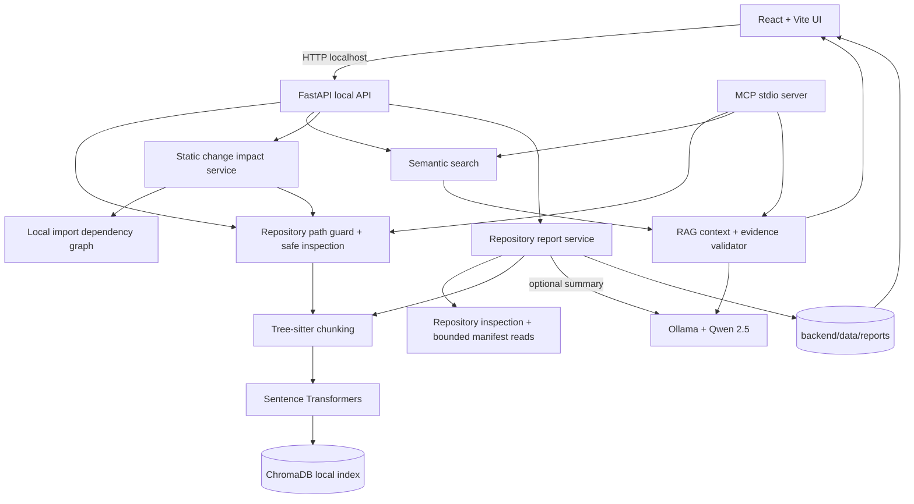

# Codebase RAG Assistant — Architecture

## Trust and data boundaries

- The FastAPI backend binds to loopback by default.
- Source repositories, embedding model, ChromaDB, Ollama and generated reports remain on the user's computer.
- A hosted frontend is optional and still calls the local backend; browser local-network restrictions apply.
- Report generation reuses repository inspection and Tree-sitter chunking. Dependency and security observations use bounded reads. The optional narrative summary calls only the local Ollama service.
- Change impact analysis builds a bounded static import graph for Python, JavaScript/TypeScript and Java. It never executes repository code and returns paths/relationships rather than source contents.
- Repository text is untrusted input. It is never executed. Security pattern matches are heuristic review prompts, not proof of vulnerabilities.
- MCP uses stdio and does not expose a network listener.

## Runtime behaviour notes (C12 refinement)

- The embedding model and the ChromaDB client are created once per process and reused (set `RAG_EMBEDDING_CACHE=0` to reload the model per request on a very small machine). Encoding is serialised and only one indexing job runs at a time; a second request gets a clear "try again" error instead of doubling memory use.
- Indexing embeds and writes chunks in slices of 64 and deletes stale entries in batches of 500, only after every slice succeeded, so a failed run never destroys the previous index.
- Change impact edges carry a confidence level; only confirmed edges feed the confirmed dependent, test and cycle results.
- Secret redaction covers quoted and unquoted assignments (JSON, YAML, `.env`, `.properties`, batch `set`), URL credentials, bearer tokens and common token formats. It stays best-effort.
- Repository inspection also skips folders named `.ssh`, `.aws`, `.gnupg`, `.kube`, `.azure`, `.docker`, `secrets`, `.secrets` and files such as `client_secret*.json` and `service-account*.json`.
