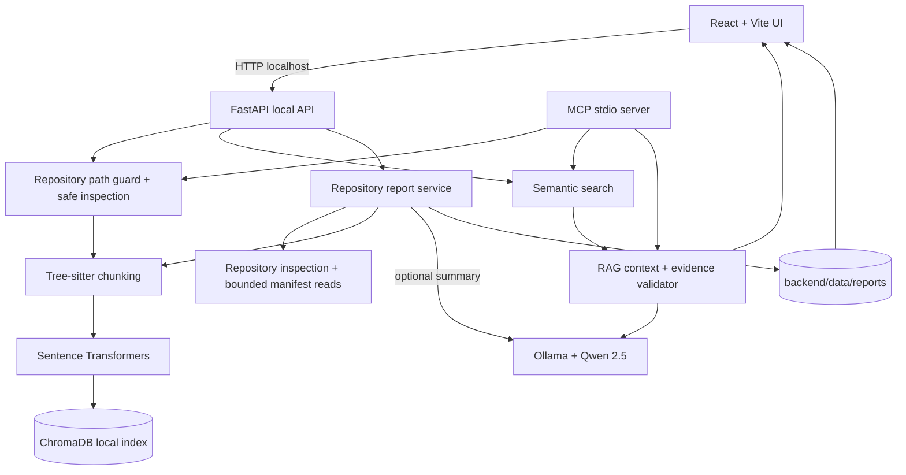

# Codebase RAG Assistant — Architecture

## Trust and data boundaries

- The FastAPI backend binds to loopback by default.
- Source repositories, embedding model, ChromaDB, Ollama and generated reports remain on the user's computer.
- A hosted frontend is optional and still calls the local backend; browser local-network restrictions apply.
- Report generation reuses repository inspection and Tree-sitter chunking. Dependency and security observations use bounded reads. The optional narrative summary calls only the local Ollama service.
- Repository text is untrusted input. It is never executed. Security pattern matches are heuristic review prompts, not proof of vulnerabilities.
- MCP uses stdio and does not expose a network listener.
